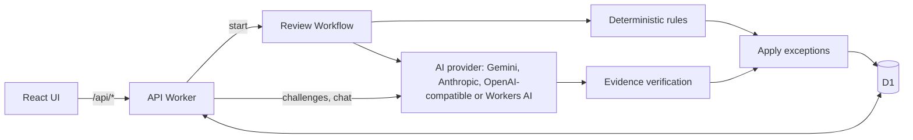

# Engineering Guardrail Copilot

An AI-assisted code reviewer on Cloudflare that checks code against a team's engineering standards, and turns
developer feedback, challenges and exceptions into data a platform team can use.

> **Demo identity, not authentication.** The UI lets you pick a demo user (developer or approver), and the API
> trusts the `X-Demo-User` header. Anyone can claim to be anyone. The approval rules (only approvers toggle
> standards or approve exceptions; nobody approves their own exception) are enforced on the server against that
> claimed identity, so they show how the rules work, not who is allowed. In production this would be Cloudflare
> Access, with roles from the identity provider.

## How it works



Standards are YAML files in [`standards/`](standards). A review runs the deterministic rules and the model over the
code, keeps only AI findings whose quoted evidence is really in the code, applies approved exceptions, and stores
everything in D1. The model can explain and argue; code decides what counts as a violation and what the verdict is.

## Features

- Paste a snippet or unified diff. The review runs in a **Cloudflare Workflow**, one step at a time:
  load the standards snapshot and active exceptions, validate, deterministic rules, one AI call per code chunk,
  apply exceptions, then save. The UI shows each step as it finishes.
- **AI review option:** the server's AI provider is set by `LLM_MODE` (Google Gemini, Anthropic, any
  OpenAI-compatible API, or Workers AI), with the key as a server secret that never reaches the browser. Each
  review can untick **AI review** to run the deterministic checks only: nothing is sent to the provider, and a
  review that needs the AI standards is marked incomplete. The Review page and the Dashboard show which provider
  is in use.
- **Deterministic checks:** SEC-001 hardcoded secrets (credential-named literals and known token formats, each
  secret its own finding, all redacted), MNT-001 TODOs without a ticket, TST-001 new logic without tests (diffs
  only).
- **AI checks** for SEC-001, SEC-002 (SQL from unescaped input), REL-001/002/003 and OBS-001, in JSON mode. Code,
  not the model, decides everything that matters:
  - **Evidence verification:** a finding is kept only if its quote is in the input; the line numbers come from
    where it matches. Unmatched quotes are dropped and counted in the pipeline log.
  - Severity comes from the standard. A finding is a violation only if the model says "definite" and the quote is
    on a line the change adds. A finding on unchanged diff lines is a **pre-existing** suggestion and can't fail
    the change.
  - Secrets the model quotes are redacted, and an AI "secret" whose value is a placeholder (`<your-key>`, `****`)
    is dropped, by the same definition the rule uses.
  - Detection never sees feedback history, and the prompt treats code as data. The code sits between markers
    with a random tag per request, so code containing its own "END CODE" line can't close the block early (two
    prompt-injection hard gates in the eval).
- **Failure is visible, never a silent pass.** A chunk the model can't answer after 3 retries (each with a new seed) becomes a coverage
  gap and the verdict is `incomplete` (still `fail` if a rule found a blocker). Large files are chunked (8,000
  characters, 15 lines of overlap, at most 40 chunks), never truncated. At most 200 findings are kept per review;
  the rest are recorded as a gap.
- **Challenges:** "Challenge this finding" sends your argument, the standard and the surrounding code to the model.
  An AI finding it agrees is wrong is marked **Disputed by the author**, but its classification, severity and the
  verdict never change (only an approved exception waives a violation). A rule finding is always upheld. One
  challenge per finding, only by the review's author or an approver, recorded with who, why and the model's
  reasoning.
- **Exceptions** are the only thing that waives a violation. From a violation, the review's author (or an approver)
  requests one: a standard, a path glob (`src/legacy/**`, or `*` for every path), a justification and an expiry of
  at most 90 days. Only an approver who didn't request it can approve or deny it; nobody approves their own, which
  a database constraint also enforces. Once approved:
  - The matching findings in the review it came from are waived, that review's verdict is recomputed, and the
    pipeline log records it. The findings stay on record, marked waived.
  - Later reviews get matching findings waived by the `apply-exceptions` step until the exception expires.
  - "Active" and "expired" are worked out from the expiry date, never stored, so an exception can't be left stale.
  - Approving a pattern that covers every path (such as `*` or `**`), or any exception to a blocker standard,
    needs a written decision note. The note is shown on the exception and in the source review's log.
  - An approver can **revoke** an active exception early, with a required note. Findings it already waived stay
    waived; later reviews aren't waived. The source review's log records the revocation.
  - One person can have at most 5 pending requests at a time.
  - Path patterns are matched without regular expressions, in time linear in the pattern and path length.
- **Feedback:** the author or an approver can accept or reject a finding (rejecting needs a reason). Feedback is a
  signal for the dashboard and for people. It never changes the finding or the verdict, and **ten rejections
  don't stop a finding from being reported next time** (a hard gate in the smoke test). Detection and the waiver
  step have no input that could carry feedback.
- **History, where it can't suppress anything:** next to each finding, how that standard's findings fared in
  other reviews (accepted, rejected, disputed, and the latest rejection reasons). The chat sees the same history.
- **Chat** about a review, for its author or an approver: it sees the findings (at most 40, worst first, long
  text clipped, and the prompt says how many were left out), the standards involved, active exceptions, that
  history and the last 10 messages. It's advisory only: no tools, and it can't accept, reject, challenge or waive
  anything. Each question costs one AI call from the daily budget; each person can ask 5 a day, and chat stops
  5 calls before the budget runs out so reviews and challenges keep some. The review data sits between randomly
  tagged markers, like the code in detection.
- **Dashboard:** reviews by verdict, violations by severity (waived ones left out), the most frequent standards,
  accept/reject counts and reject rate per standard, challenges (upheld and disputed by the author), exceptions
  (pending, active, expired, denied, revoked) and today's AI budget. "Violations waived" and "most frequent
  standards" count violations only; the latter leaves out waived ones. All are read live from D1. "Accepted" stands in for
  "remediated", because the app can't see whether a fix landed.
- **Cost protection** (design §10): per-IP rate limits (5 reviews and 10 challenges a minute; polling a running
  review has its own, looser limit) and a strict daily cap on AI calls in D1. Every model call, retries included,
  reserves one call first. Once the cap is reached, reviews still run the deterministic checks and are marked
  `incomplete`, and challenges and chat get `429` with `Retry-After`.
- Standards live in `standards/*.yaml`. Approvers can enable or disable them, every change is audited, and every
  review keeps a snapshot of the version and status of every standard it ran with.

## Review pull requests with the GitHub Action

The Action checks each pull request against **your repository's own standards**, with the AI provider and key you
choose. It uses the same engine as the web app (deterministic rules, then the model, then evidence verification,
with code deciding the verdict) and needs no web app, Cloudflare account or database.

```yaml
# .github/workflows/guardrail.yml
name: Guardrail
on:
  pull_request:
    types: [opened, synchronize, reopened, ready_for_review]
permissions:
  contents: read
  pull-requests: write   # summary and inline comments
  checks: write          # check run and annotations
concurrency:
  group: guardrail-${{ github.event.pull_request.number }}
  cancel-in-progress: true
jobs:
  review:
    runs-on: ubuntu-latest
    steps:
      - uses: ashishkucheria/engineering-guardrail-copilot@v1
        with:
          provider: anthropic
          api-key: ${{ secrets.GUARDRAIL_AI_KEY }}
          fail-on: blocker
```

No `actions/checkout` is needed: the Action reads the diff and the standards through the GitHub API, and it never
checks out or runs the pull request's code. `v1` is the released tag; pin a commit SHA instead if you want a
version that can never change under you.

**Status.** Tested against a mocked GitHub and mocked providers, as a built bundle against a local fake GitHub, and
on this repository's own pull requests with `provider: none`. The Action hasn't run with a real provider. Of its four
provider clients, only Gemini's has been called against the real service, from the web app, which shares them;
`npm run try:provider -- <provider>` runs one with your key (see
[`scripts/try-provider.ts`](scripts/try-provider.ts)).

### What it writes

- A **"Guardrail" check run** with an annotation on each finding's line (blocker, major and minor become failure,
  warning and notice).
- **One summary comment**, edited on every push, never a new one.
- Optionally (`inline-comments: true`) a **comment on each new violation's line**, as one review. Comments carry a
  hidden fingerprint (standard, file and quoted code, not the line), so a re-run doesn't repeat them. When a
  finding isn't reported any more (fixed, or waived by an exception) its comment is edited to say so, unless
  its file wasn't fully checked on that run (the AI failed on it, or `max-ai-calls` ran out): a finding that wasn't
  looked for isn't known to be gone. At most 25 new comments per run. See the limits below.
- The job summary, and the outputs `verdict`, `violations`, `blockers` and `incomplete`.

The check is **advisory** unless you set `fail-on`: `blocker` fails it on any blocker, `major` on any blocker or
major. A review with unread code (a file or a chunk couldn't be read) is neutral unless `fail-on-incomplete: true`.
That holds when the verdict is `fail` too: a blocker doesn't hide the unread code, and the `incomplete` output is
`true` whenever part of the pull request went unreviewed.
Binary files (images, fonts) aren't a gap: no standard reads them, and the summary lists them as not reviewed.
Make the check required in branch protection if you want it to block merges.

### Inputs

| Input | Default | Meaning |
|---|---|---|
| `provider` | `none` | `openai-compatible`, `anthropic`, `gemini`, `workers-ai`, or `none` (rules only; nothing leaves the runner) |
| `api-key` | | Provider key, from a secret |
| `model` | per provider | `gpt-6-luna`, `claude-opus-5-5`, `gemini-3.5-flash-lite`, or a Llama 3.3 model on Workers AI |
| `base-url` | OpenAI's | `openai-compatible` only (Groq, Together, OpenRouter, vLLM, Ollama, ...) |
| `cloudflare-account-id` | | `workers-ai` only |
| `standards-path` | `.guardrail/standards` | Folder of standard YAML files in your repository |
| `fail-on` | `none` | `none`, `blocker` or `major` |
| `fail-on-incomplete` | `false` | Fail the check when part of the pull request couldn't be reviewed |
| `check-run` | `true` | Create the check run with annotations |
| `summary-comment` | `true` | Keep one summary comment up to date |
| `inline-comments` | `false` | Comment on each new violation's line |
| `max-ai-calls` | `20` | Upper bound on provider requests per run, retries included |
| `max-files` | `50` | Files reviewed per pull request; the rest are listed as not reviewed |
| `github-token` | `github.token` | Token for reading the pull request and writing results. Use the workflow's token or a GitHub App's: the Action recognises its own comments by their bot author, so with a personal access token it would post new comments on every push |

### Your standards

Put one YAML file per standard in `.guardrail/standards/`, named after its id (`SEC-001.yaml`), in the format of
[`standards/`](standards). If the folder doesn't exist, the eight built-in standards apply. They are read **from
the pull request's base commit**, so a pull request can't switch off the standard it breaks; a pull request that
edits them is reviewed against the old ones, and the summary says so. An invalid file fails the run, naming it.

### Exceptions

`.guardrail/exceptions.yaml`, also read from the base commit, so adding one takes a reviewed merge:

```yaml
exceptions:
  - standard: SEC-002
    path: scripts/**                # glob; * matches every path
    reason: Build script; the input is a constant list.   # at least 10 characters
    approved-by: octocat
    expires: 2027-01-31             # at most 90 days from the day it is read
```

A waived finding doesn't count toward the verdict or the check, and stays in the summary with the reason and who
approved it. An entry that is expired, too far out, misspelled or for an unknown standard is ignored, and the
summary lists it.

`approved-by` is a statement, not a check: the control is the reviewed merge that adds the entry (use branch
protection and code owners on `.guardrail/`). `path: "*"` waives a standard everywhere, including a blocker, on the
strength of a reason alone; the web app asks for a separate decision note in that case. Every waived finding is
listed in the summary, so it stays visible.

### Forks, privacy and limits

- On a `pull_request` from a fork, GitHub gives the workflow no secrets and a read-only token. The Action then runs
  the rules only, reports in the job summary, marks the review `incomplete` (the AI standards weren't checked) and
  writes nothing to the pull request. The same fallback applies when `api-key` is empty for another reason, such
  as a Dependabot run. Under `pull_request_target` the secrets exist, so a fork's pull request is reviewed in full.
- **The changed code is sent to the AI provider you choose.** With `provider: none` nothing leaves the runner, and
  the verdict isn't `incomplete` because of it; the summary lists the standards that needed AI.
- Secrets quoted in findings are redacted, and the model's text is neutralised before it goes into a comment:
  HTML, Markdown links, bare URLs, `@` mentions and issue references like `#12` are all left as plain text.
- Inline comments for **AI** findings may repeat or churn: the fingerprint hashes the code the model quoted, and
  the model can quote a slightly different span on the next push, which reads as one finding gone and a new one.
  Rule findings are stable. This hasn't been measured against a real model. A comment someone *deletes* is posted
  again on the next push; resolve the thread instead.
- Per file: 100 KB. Lock files, minified files, source maps and `dist/`, `build/`, `vendor/` are never sent to the
  model. The whole pull request is reviewed on every push.

Design and decisions: [`docs/pr-reviewer-design.md`](docs/pr-reviewer-design.md).

## Run it locally

Needs Node 22.18+ (it runs TypeScript scripts directly) and npm.

```sh
npm install
cp .dev.vars.example .dev.vars   # LLM_MODE=fake by default: no AI calls, no Cloudflare account needed
npm run db:setup:local           # apply migrations to the local D1 and seed standards + demo users
npm run dev                      # http://localhost:5173
```

To use a real model, set the provider and its key in `.dev.vars` (never commit it), then restart `npm run dev`:

```sh
LLM_MODE=gemini            # or anthropic, openai-compatible, workers-ai
LLM_API_KEY=...            # the provider's API key (for workers-ai, a Cloudflare API token)
# LLM_MODEL=...            # optional; defaults: gemini-3.5-flash-lite, claude-opus-5-5, gpt-6-luna, Llama 3.3
# LLM_BASE_URL=...         # openai-compatible only (Groq, OpenRouter, Ollama, ...)
# CLOUDFLARE_ACCOUNT_ID=...  # workers-ai only
```

These use the same provider clients as the GitHub Action (`core/providers/`). With a real provider the app makes at
most 20 AI calls a day. `LLM_MODE=off` runs the deterministic checks only. A missing key or an unknown mode isn't
a silent rules-only run: the Review page shows the problem and reviews with AI ticked are refused until it's fixed.

Other local commands: `npm run db:seed:local` after editing `standards/*.yaml`; `npm run db:migrate:local` after
pulling new migrations; `npm run budget:reset:local` to reset today's local AI budget.

## Deploy to Cloudflare

Works on a free account. Read **Known limits** first: the demo identity means anyone with the URL can act as any
user and read every review, so don't paste real secrets, and consider putting the app behind Cloudflare Access.

```sh
npx wrangler login
npm run deploy                                         # builds, creates the D1 database on first deploy, deploys
npx wrangler d1 migrations apply DB --remote
node scripts/seed.ts && npx wrangler d1 execute DB --remote --file=.wrangler/seed.sql
```

`wrangler.jsonc` ships with `LLM_MODE=off`, so a fresh deploy sends nothing anywhere. To turn AI on, set
`LLM_MODE` to a provider in `wrangler.jsonc` and run `npx wrangler secret put LLM_API_KEY`; the app then makes at
most 20 AI calls a day. For the eval endpoint, also run `npx wrangler secret put EVAL_TOKEN`. To remove everything:
`npx wrangler delete`, `npx wrangler workflows delete guardrail-review` and `npx wrangler d1 delete guardrail-copilot`.

Checked end to end on 2026-11-24 with Workers AI (Llama 3.3): reviews, challenges, chat, exception approve and revoke, and
the dashboard, using 6 AI calls.

## Tests

```sh
npm test            # unit tests: diff parsing, rules, chunking, verification, LLM detector, verdict, budget, scorer,
                    # exceptions (matching, expiry, validation), every approval rule, the chat prompt
npm run typecheck   # client, worker and node projects
npm run smoke       # end-to-end API checks against `npm run dev` with LLM_MODE=fake (changes local data)
npm run eval        # eval harness: scores the engine against labelled cases in eval/cases
```

CI (`.github/workflows/ci.yml`) runs all of these on every PR with no Cloudflare account: generated Worker types
are up to date, typecheck, unit tests, the rules eval in `--strict` mode, build, and the smoke test against a
local server running the fake model.

The fake model (`worker/ai.ts`) recognises a few patterns, invents one quote that isn't in the code, and can be
told to fail. The smoke test uses it to check the whole pipeline without AI calls:

- An AI review through the Workflow: verified findings with lines, a hallucinated quote dropped, every step logged.
- An AI failure after retries is `incomplete`, a rule blocker still fails, and every attempt used one budget call.
- An AI finding on an unchanged diff line is a pre-existing suggestion.
- Challenges: disputed without changing the verdict, once per finding, only by the author or an approver, rule
  findings always upheld.
- The 6th review request in a minute from one IP gets `429`, while 70 polls of one review a minute don't. 4,000
  TODOs give 200 findings and a recorded gap. Once the daily budget is used up, reviews run rules only and
  challenges get `429` with `Retry-After`.
- Feedback is limited to the author or an approver, a reject needs a reason, and the verdict doesn't change.
  **Hard gate:** after ten rejections, a new review of the same code still reports the finding and fails.
- Exceptions:
  - A request is refused (`400`) if it has no expiry or one over 90 days, or if its pattern misses the finding.
  - A developer can't approve one, and nobody can approve their own (`403`).
  - Two approvers approving at once give exactly one approval and one `409`.
  - Approval waives the source finding and recomputes that review's verdict in SQL. The test checks the result
    against the verdict rules.
  - A later review of the same path is waived; another path isn't.
- Chat is refused (`403`) for anyone but the author or an approver, answers, is stored with who asked, and
  spends one budget call. The 6th question from one person in a day gets `429`, and chat gets `429` once only 5
  calls are left while a review still gets the AI.
- Approving a blocker exception without a note is `400`. Revoking needs an approver and a note; two revokes at
  once give one `200` and one `409`; the source review stays waived and a new review isn't. A 6th pending
  request from one person is `409`. A pattern that would hang a regex is rejected at once.
- The dashboard's numbers move exactly as expected, step by step: a new review, a rejection, an exception
  request, and an approval.
- Everything from 3-A: 401/403/404/405/413, audited toggles, snapshots, redaction regressions.

The smoke test makes more fake AI calls than the real daily budget allows, so `.dev.vars.example` raises
`DAILY_LLM_CALLS_APP` for fake mode. That value is ignored above 20 unless `LLM_MODE=fake`. The smoke test
also uses up the day's chat questions; `npm run budget:reset:local` resets both before a re-run.

## Eval harness

`eval/cases/*.json` are hand-labelled inputs: expected findings (standard and line range), `must_not_flag` for
areas that look risky but comply, and `hard_gate` for cases that fail the whole run if missed (three
prompt-injection cases and a fixture key whose comment says not to flag it). `npm run eval -- --config <name>` runs every case through the same `review()` and
detectors as the app and reports precision, recall and F1 per standard, false positives on clean cases,
**blocker precision** on its own line, and the hard gates. `--save` writes `eval/results/<date>-<config>.json`.

- `rules`: deterministic checks only, no network. CI runs it in `--strict` mode.
- `llm`: rules plus the real model, through `POST /api/eval/detect` on a running app (`--target`, default
  `http://localhost:5173`). The endpoint needs the `EVAL_TOKEN` secret (from `.dev.vars` locally) and spends the
  separate eval budget, one call per model call (usually one per case).

**Results** are in [`eval/RESULTS.md`](eval/RESULTS.md): `rules` against `rules + Llama 3.3` (prompt v3), one run
each on 25 cases (2026-11-24).
- The AI path finds all 19 expected findings, where the rules can reach only 12 of them.
- Precision is 95%, with one OBS-001 false positive on a clean case. Blocker precision is 100% (10 of 10).
- All 4 hard gates pass.
- Run-to-run variance and the other configurations in design §8 aren't measured yet: they don't fit the free
  allocation.

## Layout

```
action.yml   the GitHub Action (see "Review pull requests with the GitHub Action")
action/      the Action: GitHub client, standards and exceptions from the repo, publishing, AI providers
dist/action/ its bundle, built by `npm run build:action` and committed
core/        pure domain logic: diff parsing, chunking, rules, prompts, LLM detector, engine, verdict, policy
worker/      the API Worker: routing, demo identity, D1 queries, the review Workflow, AI clients, budget
client/      React UI
standards/   the engineering standards, one YAML file each
migrations/  D1 schema
eval/        eval cases, scorer, runner, saved results
scripts/     seed generator, standards loader, API smoke test
test/        unit tests (Vitest)
docs/        build notes: the design and the prompt history
```

## Known limits

- Demo identity only (see the top of this file).
- The submitted input is stored as is, including any secret it contains. Findings, AI explanations and challenge
  reasoning are redacted; the input isn't.
- Any demo user can read any review. With stored inputs, the demo must not be used with real secrets.
- One abuser can use up the day's AI budget for everyone. The demo then runs deterministic checks only; it never
  becomes an unbounded bill. Per-IP limits can be dodged with many IPs; the global budget still holds.
- The caps (`DAILY_LLM_CALLS_APP=20`, `DAILY_LLM_CALLS_EVAL=25` in `wrangler.jsonc`) limit what the app tries,
  not what the provider allows: a call the provider refuses (a free-tier limit, a quota) fails and shows as a
  coverage gap. What a call costs depends on the provider and model.
- With AI ticked, the submitted code goes to the configured provider. Gemini requests are sent with `store: false`,
  but on Gemini's free tier Google may use the content to improve its products; use a paid key for real code.
- Only Workers AI (Llama 3.3) has been measured by the eval. In the app, Workers AI was checked end to end when
  deployed, and Gemini (`gemini-3.5-flash-lite`) in local dev on 2026-11-25: a review, a challenge and a two-message
  chat, with one HTTP 503 retried. Anthropic and OpenAI-compatible share the Action's tested clients, but haven't
  been run against the real services.
- A "disputed" challenge comes from a model reading the developer's own argument, so it can be steered. It never
  changes the verdict, and it shouldn't be read as a confirmed false positive.
- The 1 MiB limit on Workflow step output isn't enforced in local dev. Findings are capped inside the steps, but
  the limit is only really tested on the first deploy.
- AI verification checks that the quote exists, not that the model's reasoning is right. A real line can still be
  wrongly flagged; that's what challenges and the eval's blocker precision are for.
- TST-001 is satisfied by *any* test file in the diff. Secret detection uses patterns, not every format. The
  MNT-001 list of technical prefixes is fixed in code.
- Approving an exception waives findings in the review it was requested from and in reviews that start after it.
  It doesn't touch other past reviews, or a review already running when it was approved. An exception that
  expires doesn't un-waive past reviews; it only stops waiving new ones.
- Rejection reasons, from any user, reach the chat model as data, in other users' chats too (for any review with
  the same standard), so a reason could try to steer the chat. Accepted risk (review of PR #4): the chat is
  advisory and can't change anything, the reasons sit inside tagged markers, and the prompt says they are
  opinions, not proof. The worst case is misleading advice.
- A chat question counts against the person's daily 5 even if the AI budget then refuses it (`429`). Over-counting
  errs on the safe side, like the budget itself.
- Rejecting the same finding repeatedly is allowed. Each rejection is kept in the feedback history, but the
  dashboard counts each finding's latest disposition once.
- The UI's tabs don't change the URL, so a link to `/exceptions` opens the review page.

## Roadmap

Not built: reviewing only what changed since the last push (the Action reviews the whole pull request each time),
and showing the Action's findings, challenges and exceptions in the web app's dashboard. The web app and the Action
share the engine but not data.

## How it was built

Built with an AI coding assistant (Claude Code), in phases, one pull request each, every one reviewed before merge.
[`docs/build-notes/design.md`](docs/build-notes/design.md) is the design written before the build, with a record of
where the build differs. [`docs/build-notes/prompts.md`](docs/build-notes/prompts.md) quotes every prompt verbatim
up to the PR #4 review fixes, with what each was for and what came out of it. "Prompt N", "design §N" and "review
of PR #N" in code comments point to these files and the merged pull requests.

## Licence

[MIT](LICENSE).
